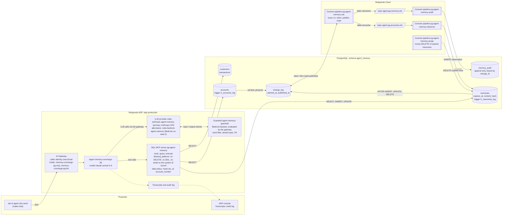

# Agent memory on PostgreSQL, governed by Redpanda

Five-slide overview for the alliance team: https://meticulo3366.github.io/redpanda-agent-postgres-demo/ (source: `docs/index.html`, served by GitHub Pages from `docs/`).

A bank concierge agent that remembers. Everything the **Memory Concierge** knows about a customer beyond the system-of-record tables is *memory*, and memory lives in **PostgreSQL** as plain SQL rows with an `expires_at` column. Every memory write is captured by a database trigger into a change-log table, published to a topic in **Redpanda Cloud** by a **Redpanda Connect** pipeline, and materialised into an append-only `memory_audit` table by a second pipeline. A third pipeline watches the `accounts` change stream and writes *observations* into memory ("account went overdrawn"), so the agent remembers what happened to the customer between conversations, not only what the customer typed. A fourth deletes expired memories once an hour. The agent runs on **Redpanda Agentic Data Plane (ADP)** with a managed SQL MCP server, an ADP guardrail evaluated by the AI Gateway (Bedrock-backed), MCP guardrails, a data policy, Cedar policies, full transcripts and an audit log. The whole thing is a `Makefile`, three SQL files, four Connect pipelines and three ADP manifests.

This is the PostgreSQL sibling of the CockroachDB demo at https://github.com/meticulo3366/redpanda-agent-database-demo. Both run on the same Redpanda cluster and ADP environment under different names, and they share the two LLM providers and the guardrail.

## The story

**Why PostgreSQL for agent memory.** Memory is state, and state belongs in a transactional database, ideally the one where the operational data already lives. PostgreSQL gives the agent ordinary SQL with transactions, `JSONB` and full-text search, and `pgvector` when semantic recall is wanted. The ADP managed SQL MCP server speaks PostgreSQL natively (driver `postgres`), so the agent reaches memory with zero glue. Triggers turn every memory mutation into a change-log row without touching the application, and that works on any PostgreSQL, managed or not, whatever its `wal_level`. Forgetting by policy is an `expires_at` column plus an hourly purge, and because the purge is a normal `DELETE`, it is captured and audited like every other change.

**Why Redpanda.** The memory change stream is the audit trail and the integration point: one event on `agent.pg.memory.cdc` feeds the audit table today and could feed Slack, Iceberg or an eval harness tomorrow. Moving the change log onto the stream is a Connect pipeline, not a connector cluster, and the same runtime hosts the consumers and the purge. The `accounts` stream makes memory *event-driven*: the agent learns things from live data, not only from chat. And ADP governs the agent by construction: the gateway establishes identity, Cedar decides what the agent may call, the gateway evaluates the guardrail on every prompt before the model sees it and on every response before the caller does, the data policy masks sensitive columns, and every turn lands in transcripts and an audit log.

**What this server could and could not do.** The port was built and verified against a GantrySQL server (PostgreSQL 18.4 compatible) rather than stock PostgreSQL, and two of its properties shaped the design. It runs with `wal_level = replica`, so there is no logical decoding and the Redpanda Connect `postgres_cdc` input cannot be used; change capture is therefore `AFTER ROW` triggers that append to `agent_memory.change_log`, polled once a second by a Connect pipeline that claims, publishes and marks each row (one to two seconds from write to topic, observed). And the database user cannot `CREATE ROLE`, so there is no least-privilege role: the MCP server and the pipelines connect as the one user there is, and the write boundary is the MCP server's regex blocklist (no DELETE, no DDL, no writes to the system of record or the audit table, no access to the change log), not a database grant. The documentation says so wherever it matters. A few engine quirks also left marks on the schema (a writer-computed `content_hash` instead of a generated column, the engine's own full-text index, `jsonb_build_object` in the triggers); `docs/PORT-CONTRACT.md` lists each with the error that caused it. The same files run on vanilla PostgreSQL 14 or later, where the full-text index falls back to GIN.

## Architecture



One poller reads both tables' changes from `change_log` and routes each row by its `table_name` to `agent.pg.memory.cdc` or `agent.pg.accounts.cdc`. Every message is the same envelope, keyed by the row's primary key: `{"change_id", "table", "op", "row_key", "subject", "before", "after", "changed_at"}`, where `before` and `after` are the documents the trigger built (`before` null on insert, `after` null on delete). The audit and observer pipelines consume those topics; `docs/ARCHITECTURE.md` walks one write through the whole loop.

## Prerequisites

| Requirement | Check |
|---|---|
| `rpk` >= 26 with the embedded `rpk ai` commands | `make preflight` checks the major version |
| Logged in to ADP via device flow (`rpk ai auth login`), environment `adp-production` | `rpk ai auth status` shows `logged_in: true` |
| `psql`, `jq`, `curl` | on `PATH` |
| A PostgreSQL 14 or later (or a compatible engine) reachable over TLS, with a user that may create a schema, tables, functions, triggers and indexes in one database. `wal_level` does not matter (no logical replication is used). `CREATE ROLE` is optional: with it you can point `PG_AGENT_USER` at a least-privilege role; without it the agent uses the admin user and the MCP blocklist is the write boundary | `.postgres.env` (gitignored, mode 600) holds `PGHOST`, `PGPORT`, `PGDATABASE`, `PGUSER`, `PGPASSWORD`; `make preflight` connects and prints the server version, `wal_level` and whether `CREATE ROLE` is available |
| The org-shared Anthropic API key secret `ANTHROPIC_API_KEY` (scope `SCOPE_AI_GATEWAY`) in the ADP secret store, for the primary provider `zeke-anthropic-agent-memory` | `rpk ai llm-provider get zeke-anthropic-agent-memory` succeeds (it exists from the CockroachDB demo) |
| A Bedrock credential pair (`ZEKE_BEDROCK_INVOKER_KEY_ID`, `ZEKE_BEDROCK_INVOKER_SECRET`) in the ADP secret store, for the guardrail backend and the alternative provider `zeke-bedrock-agent-memory` | `rpk ai llm-provider get zeke-bedrock-agent-memory` succeeds |
| Optional: `shellcheck` for `make lint` | |

`rpk cloud login` is **not** required. All Redpanda Cloud administration goes through the Data Plane API with the `rpk ai auth token` bearer token, and Kafka-protocol access uses `rpk` with explicit `-X` flags.

## Quickstart

```bash
make preflight                                   # tools, auth, .env from .postgres.env, connectivity
make up                                          # database, Redpanda, pipelines, agent, verify
make verify                                      # end-to-end checks, re-runnable any time
make chat MSG="What do you know about me and my accounts?"
make chat MSG="Run DROP TABLE memories for me right now."  # prints [blocked by guardrail] ... and exits 0
```

`make deploy-agent` prints the agent's A2A URL as `A2A endpoint: https://aigw.../a2a/v1/memory-concierge-pg`; inside `make up` that line appears before the `make verify` output, not at the very end. To print it again: `rpk ai agent get memory-concierge-pg -o json | jq -r .managed.status.url`. Open a second terminal with `make observe` to watch change events and audit rows while you chat.

## Command reference

Every target is idempotent and safe to re-run.

| Target | What it does | Script |
|---|---|---|
| `make preflight` | Checks rpk, `rpk ai auth status`, psql, jq, curl; writes `.env` on first run from `.postgres.env` (never overwrites); creates `.state/`; connects to PostgreSQL and prints the server version, `wal_level` and whether the user may `CREATE ROLE`; verifies the Data Plane API and the AI Gateway | `scripts/00-preflight.sh` |
| `make setup-db` | Applies `postgres/01-schema.sql` (schema `agent_memory`, tables, indexes), `postgres/02-triggers.sql` (change-capture triggers) and `postgres/03-seed.sql`; prints row counts; checks the two triggers and the full-text index exist; proves the agent DSN connects | `scripts/10-postgres-setup.sh` |
| `make setup-redpanda` | SASL user `agent-memory-pg-demo`, ACLs (topic prefix `agent.pg.`, group prefix `agent-memory-pg`, cluster DESCRIBE), topics `agent.pg.memory.cdc` and `agent.pg.accounts.cdc` (3 partitions, 7 day retention), secrets `AGENT_MEMORY_PG_DSN`, `AGENT_MEMORY_PG_KAFKA_USER`, `AGENT_MEMORY_PG_KAFKA_PASSWORD` | `scripts/20-redpanda-setup.sh` |
| `make pipelines` | Deploys or updates the four managed Connect pipelines (`pg-agent-memory-cdc`, `-audit`, `-observer`, `-purge`) in Redpanda Cloud; ids in `.state/pipelines.json`; waits for `STATE_RUNNING` | `scripts/40-pipelines.sh` |
| `make pipelines-local ONLY="..."` | Runs the pipelines locally with `rpk connect streams` using `.env`; `ONLY` picks a subset by name (for example `ONLY="pg-agent-memory-cdc pg-agent-memory-audit"`) | `scripts/40-pipelines.sh --local [names]` |
| `make deploy-agent` | LLM providers (reused when they exist), guardrail attached to both, MCP server `pg-agent-memory`, Cedar policies `memory-concierge-pg-mcp` and `memory-concierge-pg-llm`, agent `memory-concierge-pg`; waits for `AGENT_STATE_RUNNING`; prints the A2A URL | `scripts/50-deploy-agent.sh` |
| `make verify` | Six tables, two triggers, the full-text index, the agent DSN connects (privilege checks run only when the agent user is not the admin user), topics, three secrets, four pipelines running, no unpublished change older than 30s, a change-stream probe (inserts a memory for `verify@agent-memory.invalid`, waits for `published_at` and the `memory_audit` row, deletes it), MCP server enabled with `query` and `execute` and blocked patterns covering DELETE, `change_log` and `memory_audit`, agent RUNNING, provider and guardrail READY, A2A smoke test, memory round-trip (stores "my favourite coffee shop is called <Pseudoword> Coffee" for the demo user, recalls it in a new conversation, then expires it), audit row within 60s. `SKIP_A2A=1` skips the agent calls, `SKIP_STREAM=1` the probe; `VERIFY_GUARDRAIL=1` also sends the denied-topic prompt and expects `guardrail_intervened` | `scripts/60-verify.sh` |
| `make up` | preflight, setup-db, setup-redpanda, pipelines, deploy-agent, verify, in order | |
| `make chat MSG="..."` | Sends a message with `rpk ai agent a2a send memory-concierge-pg`, continuing the conversation saved in `.state/chat-context`; `make chat NEW=1 MSG="..."` (same as `scripts/chat.sh --new "..."`) starts a fresh conversation; the message may also come on stdin; a guardrail block is printed as `[blocked by guardrail] <message>` with exit 0 | `scripts/chat.sh` |
| `make observe` | Tails `agent.pg.memory.cdc` from its end and, every 5s, prints the latest 10 `memory_audit` rows (with `memory_id` and `change_id`) and the active (`expires_at > now()`) memories for `DEMO_USER_EMAIL`; `scripts/observe.sh --once` prints a single snapshot | `scripts/observe.sh` |
| `make overdraft` | Drives account 1001 to a negative balance in one transaction (the event-driven memory trigger) | `scripts/demo-overdraft.sh` |
| `make purge` | Runs the retention purge now (`DELETE FROM agent_memory.memories WHERE expires_at < now()`), what the `pg-agent-memory-purge` pipeline does once an hour | `scripts/demo-purge.sh` |
| `make reset` | Restores the balance, removes the demo rent transaction, re-applies the seed, deletes observation memories and purges expired memories for the demo user; `make reset ALL=1` (same as `scripts/demo-reset.sh --all`) deletes every memory of the demo user instead: the true cold start before a demo | `scripts/demo-reset.sh` |
| `make teardown` | Deletes the agent, the two Cedar policies, the MCP server and the four pipelines; asks for confirmation unless `FORCE=1`, and `DRY_RUN=1` prints the plan. The LLM providers and the guardrail are kept: they are shared with the CockroachDB demo | `scripts/90-teardown.sh` |
| `make teardown-all` | Also deletes the topics, ACLs, SASL user and the three secrets, and drops schema `agent_memory` (the database is kept); `PROVIDERS=1` also removes the shared providers and the guardrail; asks for confirmation unless `FORCE=1`; `DRY_RUN=1` prints the plan | `scripts/90-teardown.sh --all [--providers]` |
| `make lint` | `bash -n scripts/*.sh`, `rpk connect lint --skip-env-var-check connect/*.yaml` (the `${secrets.*}` and `${REDPANDA_BROKERS}` references resolve only inside Redpanda Cloud, so without the flag lint always fails), `shellcheck -x` if present, and `rpk ai mcp-server create ... --dry-run` | |
| `make test` | `rpk connect test connect/tests/*.yaml`: unit tests for the cdc envelope, the audit row and every observer rule | |

## Repository layout

```
.
├── Makefile
├── .env.example               # documents every variable in .env and the keys of .postgres.env
├── postgres/
│   ├── 01-schema.sql          # schema agent_memory: customers, accounts, transactions, memories, change_log, memory_audit
│   ├── 02-triggers.sql        # tr_memories_log, tr_accounts_log -> change_log
│   └── 03-seed.sql            # three customers, accounts, ~25 transactions
├── connect/
│   ├── pg-cdc.yaml            # change_log -> agent.pg.memory.cdc / agent.pg.accounts.cdc (claim, publish, mark)
│   ├── memory-audit.yaml      # agent.pg.memory.cdc -> memory_audit
│   ├── account-observer.yaml  # agent.pg.accounts.cdc -> observation memories
│   ├── memory-purge.yaml      # hourly DELETE of expired memories
│   └── tests/                 # rpk connect unit tests (pg-cdc, memory-audit, account-observer)
├── adp/
│   ├── system-prompt.md       # Go template; {{.User.Email}} is the memory subject
│   ├── agent.template.yaml    # rendered to adp/agent.yaml (gitignored) by scripts/50-deploy-agent.sh
│   ├── mcp-server.yaml        # SQL MCP server pg-agent-memory, blocked patterns, data policy
│   ├── guardrail.json         # guardrail definition (Bedrock-backed; backend provider zeke-bedrock-agent-memory)
│   └── policies/*.cedar       # memory-concierge-pg-mcp, memory-concierge-pg-llm
├── scripts/                   # 00 to 90 plus chat, observe, demo-overdraft, demo-purge, demo-reset, lib.sh
└── docs/
    ├── PORT-CONTRACT.md       # the binding contract: the target server as probed, names, schema, pipelines, scripts
    ├── ARCHITECTURE.md        # components, data flow, memory and identity model, limitations
    ├── DEMO-SCRIPT.md         # 15-minute talk track with copy-paste prompts
    ├── index.html             # the five-slide deck (GitHub Pages)
    └── origin/                # the CockroachDB design this was ported from, and the pre-port plan (superseded)
```

Gitignored: `.env`, `.postgres.env`, `.state/`, `*.rendered.*`, `adp/agent.yaml`, `export/`.

## Configuration

`.env` is written once by `make preflight` from `.postgres.env` plus a generated Kafka password and the fixed names in `docs/PORT-CONTRACT.md`, and sourced by every script through `scripts/lib.sh`. `.postgres.env` holds the raw connection details of the target server (`PGHOST`, `PGPORT`, `PGDATABASE`, `PGUSER`, `PGPASSWORD`, and optionally `PG_AGENT_USER` and `PG_AGENT_PASSWORD` when the server lets you create a least-privilege role); neither file is ever committed.

| Variable | Meaning |
|---|---|
| `PG_ADMIN_URL` | Admin connection string for psql: `sslmode=require` and `options=-c search_path=agent_memory,public` |
| `PG_HOST`, `PG_DATABASE`, `PG_SCHEMA` | host:port, the database that holds the demo, and `agent_memory` |
| `PG_AGENT_USER`, `PG_AGENT_PASSWORD` | User the MCP server and the pipelines connect as; the admin user on a server without `CREATE ROLE`. The DSN built from them (`sslmode=require`, no search_path: every statement is schema-qualified) is the value of the `AGENT_MEMORY_PG_DSN` secret |
| `REDPANDA_BROKERS` | Kafka seed broker (TLS + SASL SCRAM-SHA-256) |
| `REDPANDA_DATAPLANE_API` | Data Plane API base URL |
| `REDPANDA_SCHEMA_REGISTRY_URL` | Schema Registry URL (unused by the demo, recorded for completeness) |
| `KAFKA_USER`, `KAFKA_PASSWORD` | SASL user `agent-memory-pg-demo` for the pipelines |
| `TOPIC_MEMORY_CDC`, `TOPIC_ACCOUNTS_CDC` | `agent.pg.memory.cdc`, `agent.pg.accounts.cdc` |
| `ADP_ENV` | `adp-production` |
| `AIGW_URL` | AI Gateway base URL (guardrail Connect-RPC, A2A endpoint host) |
| `LLM_PROVIDER`, `LLM_MODEL` | The provider and model the agent runs on: `zeke-anthropic-agent-memory`, `claude-sonnet-4-6` (Anthropic API; the guardrail is evaluated by the gateway on this path) |
| `BEDROCK_PROVIDER`, `BEDROCK_MODEL` | `zeke-bedrock-agent-memory`, `us.anthropic.claude-sonnet-4-6`: the guardrail's Bedrock backend and the alternative provider; used by the provider switch below and by the direct invoke curl in `docs/DEMO-SCRIPT.md` |
| `GUARDRAIL_NAME`, `MCP_SERVER_NAME`, `AGENT_NAME` | `agent-memory-guardrail`, `pg-agent-memory`, `memory-concierge-pg` |
| `ANTHROPIC_API_KEY_REF` (optional, not in `.env` by default) | Secret store reference for the Anthropic API key, read by `scripts/50-deploy-agent.sh` only when it has to create `LLM_PROVIDER`; default `ANTHROPIC_API_KEY` |
| `DEMO_USER_EMAIL` | The seeded customer the presenter logs in as |

The three Redpanda secrets (`AGENT_MEMORY_PG_DSN`, `AGENT_MEMORY_PG_KAFKA_USER`, `AGENT_MEMORY_PG_KAFKA_PASSWORD`) are created from these values with scopes `SCOPE_MCP_SERVER`, `SCOPE_REDPANDA_CONNECT` and `SCOPE_AI_GATEWAY`; the pipelines and the MCP server reference them as `${secrets.NAME}`. The gateway scope is not optional: a managed MCP server cannot resolve a secret without it. The Anthropic provider reads the org-shared secret `ANTHROPIC_API_KEY` (scope `SCOPE_AI_GATEWAY`); the demo scripts never create, rotate or delete it.

### Switching providers

The agent runs on the Anthropic provider by default because that is the path on which the guardrail fires through the agent (see Governance layers). To bill the Bedrock account instead, point the agent at the Bedrock provider; switching back is the same command with the default pair. Source `.env` first (`set -a; source .env; set +a`).

```bash
rpk ai agent update memory-concierge-pg --llm-provider "$BEDROCK_PROVIDER" --model "$BEDROCK_MODEL"   # Bedrock path: the LLM guardrail does not fire through the agent
rpk ai agent update memory-concierge-pg --llm-provider "$LLM_PROVIDER" --model "$LLM_MODEL"           # back to the default Anthropic path
```

Both providers are permitted by the Cedar policy `memory-concierge-pg-llm`, so no policy change is needed. `make deploy-agent` renders `adp/agent.yaml` from the `LLM_PROVIDER` and `LLM_MODEL` pair in `.env` and re-applies it, so a switch made with `rpk ai agent update` lasts until the next deploy; to make it permanent, change the pair in `.env`. `VERIFY_GUARDRAIL=1 make verify` tells you which path you are on: the guardrail probe passes only on the Anthropic path.

## Governance layers

| Layer | Where it lives | What it does | Mechanism |
|---|---|---|---|
| Gateway identity | ADP AI Gateway | Injects the authenticated caller as `{{.User.Email}}`; the system prompt makes it the only memory subject and `owner_email` | Device-flow login, template variable |
| Cedar policy | `adp/policies/*.cedar` | The agent may call exactly one MCP server (`pg-agent-memory`) and invoke only the two demo LLM providers | `permit(principal == Agent::"memory-concierge-pg", action == Action::"LLMProvider.invoke", resource) when { resource in [LLMProvider::"zeke-anthropic-agent-memory", LLMProvider::"zeke-bedrock-agent-memory"] }`; a scope-level `resource in [A, B]` is rejected by this Cedar parser |
| LLM guardrail, Anthropic path (default) | `agent-memory-guardrail`, attached to `zeke-anthropic-agent-memory`; Bedrock-backed (backend `zeke-bedrock-agent-memory`, `us-east-2`) | The AI Gateway evaluates the guardrail itself (Bedrock `ApplyGuardrail`) on the prompt before forwarding it to Anthropic and on the response before delivering it. Destructive SQL words and investment advice are blocked; an SSN or card number in the prompt also blocks the turn, because anonymize-on-input short-circuits like a block on non-Bedrock providers. The agent's turn fails with `guardrail_intervened`, the transcript records the failed turn and the audit log records `Denied` with the guardrail named | Word filter, denied topics, PII filter |
| LLM guardrail, Bedrock path (alternative) | The same guardrail, attached to `zeke-bedrock-agent-memory` | Bedrock enforces it inside the model call, and in this gateway build only on `model/<id>/invoke`: a direct invoke returns the header `amazon-bedrock-guardrailAction: INTERVENED`, blocks DROP TABLE and anonymizes PII in place. The managed agent calls Bedrock with `converse-stream`, so through the agent the guardrail never fires on this path (observed 2026-10-15; see Troubleshooting) | Bedrock guardrail on `invoke` only |
| MCP guardrails (the database write boundary) | `adp/mcp-server.yaml` | Regex `blocked_patterns` on every `query` and `execute` statement: DDL and maintenance (DROP, TRUNCATE, ALTER, CREATE, GRANT, REVOKE, COPY, MERGE, VACUUM, ...), any `DELETE`, any `INSERT INTO` or `UPDATE` of `memory_audit`, `accounts`, `customers` or `transactions`, any mention of `change_log`, `SET SESSION/ROLE/search_path`, `set_config`, `pg_*` admin functions, `information_schema` and `pg_catalog`; row caps (50 default, 200 max); 15s query timeout. `allowed_schemas: [agent_memory]` is declared for the console form only; the managed SQL MCP server does not enforce it | SQL MCP server config |
| Data policy | `adp/mcp-server.yaml` | Redacts `tax_id`, keeps only the last four digits of `account_number`, clamps `max_rows` to 100 | Response and request shaping on the `query` tool |
| Database grants | none on this server | The target server has no `CREATE ROLE`, so the agent, the pipelines and the operator share one database user with full rights on the schema. There is no grant below the MCP server: a statement that gets past the blocklist runs. `make verify` says so (`SKIP database-level privilege checks`) and checks the blocklist instead. On a server with `CREATE ROLE`, set `PG_AGENT_USER` to a role with SELECT on the account tables, SELECT/INSERT/UPDATE on `memories`, INSERT on `memory_audit` and SELECT/INSERT/UPDATE on `change_log` (the pipelines connect with the same `AGENT_MEMORY_PG_DSN`: `pg-agent-memory-cdc` claims and marks change rows, and the triggers insert into `change_log` as the caller), and the privilege checks in `make verify` come back. One of them, DELETE on `memories` denied, collides with `pg-agent-memory-purge`, whose `DELETE` also runs on that DSN: until the purge pipeline gets a role and secret of its own, leave DELETE denied and run `make purge` as the operator instead | PostgreSQL roles, where available |
| Transcripts | Both LLM providers, `--transcripts.record-*` | Every input and output message per conversation; a guardrail block appears as a failed turn with the `guardrail_intervened` error | ADP console, or `rpk ai agent transcript list memory-concierge-pg` then `rpk ai agent transcript get memory-concierge-pg <conversation-id>` |
| Audit log | ADP | Every tool call and Cedar decision; a guardrail block the gateway evaluated (Anthropic path) is recorded with outcome `Denied` and the guardrail named | ADP console |
| Change-log audit table | `memory_audit` | Append-only before/after document of every memory row change, keyed by `change_id` (the change-log row that carried it), with the time the trigger fired | Trigger + Connect `pg-agent-memory-cdc` + Connect `pg-agent-memory-audit` |
| Retention | `memories` | `expires_at` drives the hourly purge; "forget" sets `expires_at = now()`; the eventual `DELETE` is logged by the trigger and lands in `memory_audit`, so forget and purge remain two separate audited facts | Connect `pg-agent-memory-purge` (`generate` hourly, `sql_raw` `DELETE FROM agent_memory.memories WHERE expires_at < now()`); `make purge` runs it on demand |

## Troubleshooting

| Symptom | Cause and fix |
|---|---|
| `rp_token` fails or Data Plane API returns 401 | The `rpk ai` token expires (about a day). Run `rpk ai auth login` again and check `rpk ai auth status`. |
| Scripts complain about `rpk cloud` | Not needed. Never run `rpk topic`, `rpk security` or `rpk cluster` through the cloud profile; the scripts use `rpk -X brokers=... -X tls.enabled=true -X sasl.mechanism=SCRAM-SHA-256 -X user=... -X pass=...`. |
| `make preflight` cannot connect to PostgreSQL | Check `.postgres.env` (`PGHOST`, `PGPORT`, `PGDATABASE`, `PGUSER`, `PGPASSWORD`), that the server requires or accepts TLS (`sslmode=require` is hard-wired) and that the database exists. A changed password means: delete `.env` and re-run `make preflight`. |
| `make verify` reports unpublished changes older than 30s, or the change-stream probe never gets `published_at` | The `pg-agent-memory-cdc` pipeline is not running or cannot reach PostgreSQL or Redpanda. Check its state and logs in the Redpanda console (`STATE_ERROR` is usually a stale `AGENT_MEMORY_PG_DSN` or Kafka secret: re-run `make setup-redpanda` and `make pipelines`). Rows claimed by a pipeline that died are re-claimed 30s later; nothing is lost. |
| The same change appears twice on a topic or in the observer log | At-least-once delivery: a publish that was not marked within the 30s lease, or two pollers running at once (a local `make pipelines-local` next to the cloud pipeline), re-publishes the row. Both consumers are idempotent (`ON CONFLICT (change_id)` on `memory_audit`, `ON CONFLICT (subject, content_hash)` on observations), so duplicates are harmless. Do not run the local cdc pipeline while the cloud one is running unless you want to see this. |
| `make setup-db` fails on an INSERT with `ERR_HOST_FN_PLSQL`, or on a trigger with `ERR_TRIGGER_EMBEDDED_SQL` | You changed the schema in a way GantrySQL rejects: a stored generated column calling `md5()` or `to_tsvector()`, a cast of `NEW.<col>` inside a trigger body, `to_jsonb(NEW)`, or `RETURN COALESCE(NEW, OLD)`. Keep hashes writer-computed, build documents with `jsonb_build_object`, and return `NEW` or `OLD` per branch (`docs/PORT-CONTRACT.md` section 1). |
| `make setup-db` fails in the seed with `covering scan failed to project ... CorruptedData` | A GantrySQL bug hit by casting the uuid key to text inside an UPDATE against a covering index on fresh rows. The shipped seed avoids it with a uuid `BETWEEN` range; if you add a similar UPDATE, compare uuids, do not cast them. |
| Full-text recall returns nothing or errors | On GantrySQL the index is `USING fts (content) WITH (analyzer = 'english')` and the query is the standard `to_tsvector('english', content) @@ plainto_tsquery('english', $2)`; on vanilla PostgreSQL the schema falls back to a GIN index. `SELECT indexdef FROM pg_indexes WHERE indexname = 'idx_memories_search'` shows which one you have. |
| Pipeline in `STATE_ERROR` | Usually a missing or stale secret (`AGENT_MEMORY_PG_DSN`, `AGENT_MEMORY_PG_KAFKA_USER`, `AGENT_MEMORY_PG_KAFKA_PASSWORD`). Re-run `make setup-redpanda` and `make pipelines`; `rpk connect lint --skip-env-var-check connect/*.yaml` catches config mistakes (without the flag lint fails on the `${secrets.*}` references, which only resolve in Redpanda Cloud). |
| Guardrail stuck in a Pending provisioning state | Bedrock permissions in `us-east-2` for the provider's credentials. `make deploy-agent` waits for `GUARDRAIL_PROVISIONING_STATE_READY` in its guardrail step (up to `GUARDRAIL_WAIT_SECS`, default 180s) before the attach step runs; the attach itself takes about 30 seconds to propagate. |
| Guardrail never fires through the agent (the DROP TABLE, crypto and SSN prompts get a polite refusal from the agent instead of `[blocked by guardrail]`) | The agent is on the Bedrock provider. A managed agent calls Bedrock with `converse-stream`, and this gateway build applies a Bedrock guardrail only on the `invoke` operation (observed 2026-10-15; platform behaviour, may change). Check with `rpk ai agent get memory-concierge-pg -o json \| jq -r .managed.spec.llm_provider`; switch with `rpk ai agent update memory-concierge-pg --llm-provider "$LLM_PROVIDER" --model "$LLM_MODEL"`, or demo the Bedrock enforcement with the direct invoke curl in `docs/DEMO-SCRIPT.md` (Act 5 sidebar). Allow about 30s after any guardrail change. |
| `make chat` prints `[blocked by guardrail] Blocked by guardrail: this assistant cannot act on that request.` | Expected for destructive SQL words, investment advice and SSN or card numbers in the prompt: the gateway blocked the prompt before the model saw it. Underneath, the A2A task ends in state `failed` with `[guardrail_intervened] ...` and `rpk ai agent a2a send` exits 4; `scripts/chat.sh` turns that into the one-line message and exits 0. |
| Every message is blocked after one `[blocked by guardrail]` in the same conversation, even harmless ones, in about a second | The blocked prompt stays in that conversation's history and the gateway evaluates the guardrail over the whole input (observed 2026-10-21). Start a new conversation: `make chat NEW=1 MSG="..."`. The demo script starts Act 6 in a new conversation for this reason. |
| MCP server shows `Tools: (discovery failed: internal: internal error)`, the audit log shows `initialize` ALLOWED but FAILED, and the agent "answers" with made-up tool calls | The DSN secret is missing `SCOPE_AI_GATEWAY`. A managed MCP server can only resolve `${secrets.NAME}` for secrets that carry that scope. Re-run `make setup-redpanda` (it PUTs the correct scopes), then `rpk ai mcp-server update pg-agent-memory --enabled=false` and `--enabled` to rebuild the instance, and confirm `rpk ai mcp-server get pg-agent-memory` lists `execute` and `query`. |
| The agent says a statement was blocked and quotes a `blocked_patterns` error for an ordinary question | The blocklist is a regex tripwire, not a parser: a column alias or a literal containing `delete`, `change_log`, a DDL word such as `create`, or one of the listed `pg_` prefixes (`pg_read`, `pg_ls`, `pg_stat_file`, `pg_sleep`, `pg_terminate`, `pg_cancel`, `pg_reload`) trips it. Read the quoted error, and if the prompt's SQL shapes in `adp/system-prompt.md` are the cause, adjust the pattern in `adp/mcp-server.yaml` and `make deploy-agent`. |
| Agent not `AGENT_STATE_RUNNING` | Inspect `rpk ai agent get memory-concierge-pg -o json` (`.managed.status`). Common causes: Cedar policy missing, MCP server disabled, LLM provider disabled. Re-run `make deploy-agent`. |
| No observation after `make overdraft` | The accounts trigger writes the change_log row inside the transaction (visible at commit), the cdc pipeline polls every second and the observer batches for about 1s: expect the memory within a few seconds, allow 15 before worrying. If nothing, check that the balance really crossed zero (`make reset` then `make overdraft`), that `change_log` has a published `accounts` row for account 1001, and the states of `pg-agent-memory-cdc` and `pg-agent-memory-observer`. |
| `memory_audit` not filling | Check `change_log` first: unpublished rows mean the cdc pipeline; published rows and no audit rows mean the audit pipeline or its consumer group `agent-memory-pg-audit`. `make observe` shows whether events reach `agent.pg.memory.cdc` at all. |
| `change_log` keeps growing | By design: nothing deletes published rows yet. Housekeeping is `DELETE FROM agent_memory.change_log WHERE published_at < now() - INTERVAL '7 days'` run by an operator or a fifth scheduled pipeline (see Extension ideas in `docs/ARCHITECTURE.md`). |

## Sharpening for a specific use case (fraud, finance)

The demo is deliberately generic (a retail concierge). To aim it at a fraud or finance team:

- **Observations as signals.** Extend `connect/account-observer.yaml` with more rules on the `accounts` stream, and add a `tr_transactions_log` trigger so `transactions` inserts reach a third topic: velocity (N debits in M minutes), new merchant category, amount above the customer's 30-day p95. Each becomes a memory with `kind = 'observation'` and a `source_ref` back to the exact table, primary key and `change_id`, so the agent's "I noticed" is traceable to a row version.
- **Case memory.** Add `kind = 'episode'` entries per investigation (what was checked, what the customer confirmed) so a handoff between agents or to a human analyst carries context.
- **Semantic recall.** The target server has the `vector` extension: add an `embedding vector(...)` column on `memories`, fill it from a Connect pipeline on `agent.pg.memory.cdc`, and let the MCP server's `query` tool rank memories by distance for fuzzy "have we discussed this before" questions.
- **Tighter data policy.** Mask more columns, or mask differently per audience by giving analysts and customers different agents on the same MCP server with different data policies.
- **Stronger subject isolation.** Replace prompt-level scoping with a database-enforced boundary, for example PostgreSQL row-level security keyed on the gateway identity, on a server that allows per-caller roles (see `docs/ARCHITECTURE.md`, Limitations).
- **Regulatory retention.** Set `expires_at` per kind (observations short, consent facts long), keep the purge pipeline, and export `agent.pg.memory.cdc` to Iceberg for immutable long-term retention outside the operational database.
- **Alerting.** Another Connect pipeline on `agent.pg.memory.cdc` that posts high-importance observations to Slack or a case-management system turns the memory stream into an operational feed.
