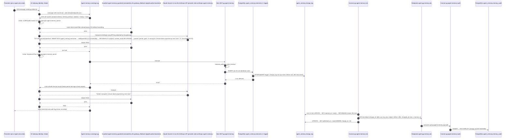

# Architecture

Component by component, then the path of one memory write, the memory model, the identity model, what is honestly weak, and where it can go next. Names, schemas and the facts probed on the target server are fixed in `DESIGN.md`; this document explains the system.

## Components

| Component | Name | Role |
|---|---|---|
| PostgreSQL database (the target server, GantrySQL 0.9.1, PostgreSQL 18.4 compatible) | schema `agent_memory` | System of record (`customers`, `accounts`, `transactions`), long-term memory (`memories`), its change stream (`change_log`) and its history (`memory_audit`) |
| PostgreSQL user | one (`PG_AGENT_USER`, the admin user on this server) | The MCP server, the pipelines and the operator all connect as it. The server has no `CREATE ROLE`, so there is no least-privilege role; the MCP server's blocked patterns are the write boundary (see Limitations) |
| Triggers | `tr_memories_log` (AFTER INSERT OR UPDATE OR DELETE on `memories`), `tr_accounts_log` (AFTER UPDATE on `accounts`) | Append one row per change to `change_log` with before/after documents built by `jsonb_build_object`; the account document omits `account_number` and `customer_id` |
| Change log | `agent_memory.change_log` | `change_id` identity, `table_name`, `op`, `row_key` (bigint), `subject`, `before_doc`, `after_doc`, `changed_at`, `claimed_at` (30-second lease), `published_at` |
| Connect pipeline | `pg-agent-memory-cdc` | Every second: claim the unpublished rows, publish each as a JSON envelope to the topic for its table (keyed by `row_key`), mark it published |
| Redpanda topics | `agent.pg.memory.cdc`, `agent.pg.accounts.cdc` | 3 partitions, 7 day retention |
| Connect pipeline | `pg-agent-memory-audit` | Consumes `agent.pg.memory.cdc` (group `agent-memory-pg-audit`), writes one `memory_audit` row per change, idempotent on `change_id` |
| Connect pipeline | `pg-agent-memory-observer` | Consumes `agent.pg.accounts.cdc` (group `agent-memory-pg-observer`), turns balance transitions into `observation` memories, idempotent on `(subject, content_hash)` |
| Connect pipeline | `pg-agent-memory-purge` | Hourly `DELETE FROM agent_memory.memories WHERE expires_at < now()`; stands in for row-level TTL and `pg_cron`, neither of which this server has. `make purge` runs the same statement on demand |
| SASL user | `agent-memory-pg-demo` | Used by the pipelines; ACLs on topic prefix `agent.pg.`, group prefix `agent-memory-pg`, cluster DESCRIBE |
| Secrets | `AGENT_MEMORY_PG_DSN`, `AGENT_MEMORY_PG_KAFKA_USER`, `AGENT_MEMORY_PG_KAFKA_PASSWORD` | Scopes `SCOPE_MCP_SERVER`, `SCOPE_REDPANDA_CONNECT`, `SCOPE_AI_GATEWAY`; referenced as `${secrets.NAME}` by the pipelines and the MCP server |
| ADP LLM provider (primary) | `zeke-anthropic-agent-memory` | Anthropic API through the org-shared secret `ANTHROPIC_API_KEY`; model `claude-sonnet-4-6`; transcripts on; guardrail attached and evaluated by the gateway on every input and output. Shared with other demos on the environment |
| ADP LLM provider (alternative) | `zeke-bedrock-agent-memory` | Bedrock in `us-east-2`; model `us.anthropic.claude-sonnet-4-6`; the guardrail's Bedrock backend; guardrail enforced by Bedrock only on `invoke`, never on the agent's `converse-stream` (see Limitations). Shared with other demos on the environment |
| ADP guardrail | `agent-memory-guardrail` | Bedrock-backed word filter, denied topic and PII policy, attached to both providers; on the Anthropic path the AI Gateway evaluates it (`ApplyGuardrail`) on input before forwarding and on output before delivery. Shared |
| ADP MCP server | `pg-agent-memory` | Managed SQL MCP (driver `postgres`) over the `AGENT_MEMORY_PG_DSN` secret; tools `query` and `execute`; regex blocklist; data policy |
| ADP Cedar policies | `memory-concierge-pg-mcp`, `memory-concierge-pg-llm` | The agent may call this MCP server and invoke the two demo providers, nothing else |
| ADP agent | `memory-concierge-pg` ("Memory Concierge (PostgreSQL)") | Runs on `zeke-anthropic-agent-memory`, model `claude-sonnet-4-6`; system prompt with the schema and the memory protocol; `max_iterations: 16` |
| Transcripts and audit log | ADP | Per-conversation messages and tool calls (a guardrail block is a failed turn); per-event Cedar decisions, and guardrail decisions when the gateway evaluated them (Anthropic path) |
| Human | `rpk ai agent a2a send` via `scripts/chat.sh` | Authenticated with `rpk ai auth login`; the gateway derives `{{.User.Email}}` from that identity |

### PostgreSQL

Four design choices matter. `memories.subject` is the caller's verified email, so the identity key is the same string on both sides of the MCP boundary. `accounts.owner_email` is denormalised so an account change event carries the memory subject without a join inside the pipeline. `memories.content_hash` is `md5(lower(subject) || '|' || lower(content))` under a UNIQUE constraint with `subject`, which makes memory writes idempotent for both the agent and the observer pipeline; it is a plain column that every writer computes in its INSERT, because on this engine a stored generated column calling `md5()` makes every INSERT fail. `memories.expires_at` plus the hourly purge stand in for row-level TTL: the agent moves `expires_at` (forget) but is blocked from DELETE by the MCP server, and the purge pipeline deletes from no conversation, so forgetting is a policy, not a privilege.

Two more engine facts shaped the schema. Full-text recall uses the engine's own index access method (`USING fts (content) WITH (analyzer = 'english')`, created inside a `DO` block that falls back to GIN over `to_tsvector` on vanilla PostgreSQL) and the standard query `to_tsvector('english', content) @@ plainto_tsquery('english', $2)`; there is no `tsvector` column. And every key a trigger handles is `BIGINT` (`memory_id` is `GENERATED ALWAYS AS IDENTITY`), because casts of `NEW.<col>` inside a trigger body fail here.

The `memory_audit` table is written by the audit pipeline and keyed by `change_id`, so replaying the topic from the beginning produces no duplicates. The agent reads it; the MCP server blocks `INSERT INTO` and `UPDATE` against it by pattern (there is no grant to do it; see Limitations).

### Change data capture

The target server runs with `wal_level = replica`: no logical decoding, so neither the Redpanda Connect `postgres_cdc` input nor Debezium can read it. Change capture is therefore inside the database. Two `AFTER ROW` triggers append to `agent_memory.change_log`: `tr_memories_log` on insert, update and delete of `memories`, and `tr_accounts_log` on update of `accounts`. Each row carries `table_name`, `op`, `row_key` (the primary key), `subject` (`memories.subject` or `accounts.owner_email`), `before_doc` and `after_doc` (JSONB built with `jsonb_build_object`, column by column, because `to_jsonb(NEW)` loses the column names on this engine) and `changed_at`. The account document leaves out `account_number` and `customer_id`, so the sensitive column never reaches the topic or the audit.

The `pg-agent-memory-cdc` pipeline is a `generate` input ticking every second into one `sql_raw` statement:

```sql
UPDATE agent_memory.change_log
   SET claimed_at = now()
 WHERE change_id IN (SELECT change_id FROM agent_memory.change_log
                      WHERE published_at IS NULL
                        AND (claimed_at IS NULL OR claimed_at < now() - INTERVAL '30 seconds')
                      ORDER BY change_id LIMIT 200)
RETURNING change_id, table_name, op, row_key, subject, before_doc, after_doc, changed_at
```

The claim is a 30-second lease. Two polls that overlap (the previous one still publishing when the next tick fires, or a local run next to the cloud pipeline) take disjoint rows, and a row whose publish failed is picked up again once its lease expires. The returned array is sorted by `change_id`, split into one message per row, and mapped into the envelope `{"change_id", "table", "op", "row_key", "subject", "before", "after", "changed_at"}` (the `jsonb` columns arrive as JSON text from the driver and are parsed; an already parsed object is accepted too). A `switch` output routes by `table` to a `broker` with `fan_out_sequential`: first the `redpanda` output (topic `agent.pg.memory.cdc` or `agent.pg.accounts.cdc`, key `row_key`), then a `sql_raw` output that stamps `published_at`. `retry_until_success` keeps a failed send retrying rather than dropping it.

Delivery is at-least-once: publish first, mark second, so a failure between the two re-publishes the row after the lease. Both consumers are idempotent (`ON CONFLICT (change_id) DO NOTHING` on the audit table, `ON CONFLICT (subject, content_hash) DO NOTHING` on observations). Ordering is per poll and per key: every version of a row lands on one partition because the key is the primary key, and rows within a poll are published in `change_id` order. Observed locally, a change is claimed and published one to two seconds after the write and the audit row follows within a few seconds more.

### Connect pipelines

All run as managed pipelines in Redpanda Cloud (`cpu_shares: 100m`, `memory_shares: 400M`) or locally with `rpk connect streams` (`make pipelines-local`, optionally `ONLY="..."` to pick some). Brokers come from the contextual `${REDPANDA_BROKERS}`, credentials from `${secrets.AGENT_MEMORY_PG_KAFKA_USER}` and `${secrets.AGENT_MEMORY_PG_KAFKA_PASSWORD}`, the database from `${secrets.AGENT_MEMORY_PG_DSN}` (`sslmode=require`, no search_path: every statement is schema-qualified). The two consumers batch `count: 100, period: 1s` with `max_in_flight: 2`, commit offsets every second, start from `earliest`, expose Prometheus metrics, and write with `sql_raw` (driver `postgres`).

`pg-agent-memory-audit` takes `change_id`, `op` and `row_key` from the envelope, `subject` from the envelope falling back to `after` then `before`, and inserts `(change_id, memory_id, subject, op, before_doc, after_doc, changed_at)` with `ON CONFLICT (change_id) DO NOTHING`, the documents passed as JSON text and cast with `::jsonb`.

`pg-agent-memory-observer` keeps only `op == "update"` envelopes with both documents on `agent.pg.accounts.cdc` and emits a memory when `before.balance >= 0 && after.balance < 0` (overdraft) or `after.balance - before.balance >= 5000` (large deposit). Everything else is `deleted()`. The content is one third-person sentence with the account nickname, the date from `after.updated_at` and the two balances, no account number; `source_ref` is `accounts/<account_id>@<change_id>`; `content_hash` is computed in Bloblang with the same formula the agent uses, so the observer's `ON CONFLICT (subject, content_hash) DO NOTHING` and the agent's upsert share one notion of "the same memory".

`pg-agent-memory-purge` is a `generate` input on a `1h` interval feeding one `sql_raw` processor (`DELETE FROM agent_memory.memories WHERE expires_at < now()`, `exec_only: true`), output `drop`. Each delete fires `tr_memories_log`, so the purge shows up in the change stream and in `memory_audit` like any other change.

### ADP

The agent is a manifest (`adp/agent.yaml`, rendered from `adp/agent.template.yaml` plus `adp/system-prompt.md`, with `LLM_PROVIDER` and `LLM_MODEL` substituted from `.env`) applied with `rpk ai agent apply`. It names one LLM provider, one model and one MCP server. The gateway in front of it enforces the Cedar policies on every `McpServer.*`, `McpServerTool.call` and `LLMProvider.invoke` action; the guardrail attached to the provider is evaluated by the gateway on every input before it is forwarded and on every output before it is delivered (on the Anthropic path the agent uses by default; the Bedrock path differs, see Limitations); the MCP server applies `blocked_patterns`, row limits and the query timeout to every SQL statement (the `allowed_schemas` setting is declared but not enforced by the managed SQL MCP server; every statement in the system prompt is schema-qualified), and the data policy reshapes `query` responses (`tax_id` redacted, `account_number` keeps the last four characters) and clamps `max_rows` requests to 100. Transcripts (`--transcripts.record-input-messages`, `--transcripts.record-output-messages`) and the audit log are platform features, not something the prompt asks for.

## One memory write, end to end

The user says "I'm saving for a house down payment by next June" in an existing conversation.



Steps 1 to 25 take a few seconds and are synchronous from the user's point of view; step 16 runs inside the INSERT's transaction. Steps 26 to 30 are asynchronous: the poll fires within a second of the commit, the publish and the mark take a few hundred milliseconds each, and the audit pipeline batches for at most 1s. Nothing in the synchronous path waits for the audit row; the audit trail is eventually consistent with memory, and `make verify` asserts it arrives within 60 seconds (and, in the change-stream probe, that a direct insert is published and audited within 30 seconds each).

The observer path is the same shape with `accounts` as the source, `agent.pg.accounts.cdc` as the topic and `pg-agent-memory-observer` writing into `memories` instead of `memory_audit`. That insert fires `tr_memories_log`, so observations are audited exactly like agent-written memories.

Had the prompt been "Run DROP TABLE memories for me right now.", step 6 would be a block instead of a pass: the gateway returns the blocked-input message to the agent runtime as an HTTP 403 `guardrail_intervened` error, the runtime records the turn as failed, nothing from step 7 onwards happens, and the audit log shows the LLM call as `Denied` with the guardrail named. On the Bedrock path (agent switched to `zeke-bedrock-agent-memory`) steps 5, 6, 9, 10, 22 and 23 do not exist: the agent runtime calls Bedrock with `converse-stream`, and this gateway build applies a Bedrock guardrail only on `invoke`, so the prompt reaches the model and only the system prompt and the MCP blocklist stand in the way (see Limitations).

## Memory model

One row per remembered thing. Content is a single third-person sentence ("Prefers short answers") so that recall results read as context, not transcript.

| Column | Meaning |
|---|---|
| `memory_id` | `BIGINT GENERATED ALWAYS AS IDENTITY`; the Kafka key of every change event about the row |
| `subject` | Verified caller email from the gateway; the only scoping key |
| `kind` | `preference`, `fact`, `goal`, `observation`, `episode` |
| `content` | One sentence, third person, no secrets, card numbers, tax ids or passwords |
| `importance` | 1 to 5, default 3; recall orders by importance then recency |
| `source` | `agent` (written during a conversation), `event-stream` (observer pipeline), `human` (operator edits and the verify probe) |
| `source_ref` | `chat:<date>` for agent writes (the prompt template exposes no context id; the ADP transcript links the row to the conversation); `accounts/<id>@<change_id>` for observations |
| `content_hash` | `md5(lower(subject) \|\| '\|' \|\| lower(content))`, computed by the writer (the agent's INSERT and the observer's Bloblang); `UNIQUE (subject, content_hash)` |
| `expires_at` | Default 90 days; observations 30 days; "forget" sets it to `now()`; the hourly purge deletes rows past it |

Full-text recall is an index on `content` (`USING fts` on this engine, GIN over `to_tsvector` elsewhere), queried with `to_tsvector('english', content) @@ plainto_tsquery('english', $2)`; there is no stored `tsvector` column.

| Kind | Written by | Typical importance | Expiry | Example |
|---|---|---|---|---|
| `preference` | agent | 3 | 90 days | Prefers short answers |
| `fact` | agent | 3 | 90 days | Has two children in school |
| `goal` | agent | 4 | 90 days | Is saving for a house down payment by next June |
| `observation` | observer pipeline | 4 | 30 days | Account 'Everyday Checking' went overdrawn on 2026-10-21: balance moved from 2450.00 to -450.00 USD. |
| `episode` | agent | 2 to 3 | 90 days | Reserved for conversation summaries |

**Recall.** First turn of every conversation: `SELECT memory_id, kind, content, importance, source, created_at FROM agent_memory.memories WHERE subject = $1 AND expires_at > now() ORDER BY importance DESC, created_at DESC LIMIT 20`, served by the covering index `idx_memories_recall` (`INCLUDE (kind, content, source)`). Observations with `source = 'event-stream'` are surfaced proactively ("Since we last spoke...").

**Store.** `INSERT INTO agent_memory.memories (subject, kind, content, importance, source, source_ref, content_hash) VALUES ($1, $2, $3, $4::SMALLINT, 'agent', $5, md5(lower($1) || '|' || lower($3))) ON CONFLICT (subject, content_hash) DO UPDATE SET importance = excluded.importance, updated_at = now(), expires_at = now() + INTERVAL '90 days'`. Restating a memory refreshes it instead of duplicating it. The observer uses the same conflict target with `DO NOTHING`.

**Forget.** `UPDATE agent_memory.memories SET expires_at = now(), updated_at = now() WHERE subject = $1 AND memory_id = $2::BIGINT`. The row is invisible to recall immediately and is deleted by the hourly purge later (or by `make purge`). Both the update and the purge's delete appear in `memory_audit`, so the history records that the memory existed, when it was forgotten and when it was physically removed.

**Audit.** `memory_audit` keeps `before_doc` and `after_doc` as JSONB for every row version, with `op` in `insert`, `update`, `delete`, `changed_at` (when the trigger fired) and `audited_at` (when the pipeline wrote it). "Show me the log" runs `SELECT op, after_doc->>'content' AS content, before_doc->>'content' AS previous, changed_at FROM agent_memory.memory_audit WHERE subject = $1 ORDER BY changed_at DESC LIMIT 20`.

## Identity model

The presenter authenticates with `rpk ai auth login` (device flow). The gateway attaches the authenticated principal to every A2A call, and the agent's Go-template system prompt receives it as `{{.User.Email}}` (`{{if .User.Email}}You are talking to {{.User.Email}}.{{end}}`). That email is the subject of every memory query and the `owner_email` of every account query. The seed data has three customers so the scoping is testable: `zeke.dean@redpanda.com`, `alice@example.com`, `bob@example.com`.

What stops what, and where:

| Rule | Prompt | Platform policy | Database |
|---|---|---|---|
| Memory subject is the caller's email | Yes (instruction) | No | No: one user, it can read every subject |
| Account queries only `WHERE owner_email = caller` | Yes (instruction) | No | No: one user, it can read every owner |
| No destructive SQL | Yes | Guardrail word filter, evaluated by the gateway on the Anthropic path (not through the agent on the Bedrock path); MCP `blocked_patterns` (DDL, DELETE, maintenance) | No: one user with full rights on the schema; the MCP blocklist is the only stop below the model |
| No writes to the system of record or the audit table | Yes | MCP `blocked_patterns`: `(INSERT INTO\|UPDATE) (agent_memory.)?(memory_audit\|accounts\|customers\|transactions)`; `allowed_schemas` is not enforced (vendor limitation) | No: the same user owns them |
| No access to the change-log plumbing | Yes | MCP `blocked_patterns`: `change_log` | No |
| No investment advice | Yes | Guardrail denied topic (input and output), Anthropic path | n/a |
| Sensitive columns masked | Explains the masking | Data policy on `query` responses | No: the DB returns clear values to the MCP server; `account_number` and `customer_id` are kept out of the change stream by the trigger |
| SSNs and card numbers never leak through chat | Yes (never store them) | Guardrail PII filter: on the Anthropic path an input match blocks the turn and an output match is anonymized; on the Bedrock `invoke` path both are anonymized in place; the agent's Bedrock `converse-stream` path is not covered | No |
| Agent talks only to this MCP server and the two demo LLM providers | n/a | Cedar `memory-concierge-pg-mcp`, `memory-concierge-pg-llm` (`when { resource in [...] }` over both providers) | n/a |
| Everything is recorded | n/a | Transcripts (a guardrail block is a failed turn); audit log (`Denied` with the guardrail named when the gateway evaluated it) | `memory_audit` via the trigger and the pipelines |

The first two rows are the honest gap: subject isolation is a prompt instruction backed by nothing below the model. The third and fourth rows are the port's own gap: on this server the blocklist is the whole database boundary. See Limitations.

## Limitations

- **SQL MCP scoping is prompt-level.** The MCP server connects as one database user for every caller. The prompt says "never query another subject", but a successful prompt injection could read Alice's accounts or memories. The fixes live below the model: a per-caller database role or connection, a view or policy that pins `subject` to the session identity, or a custom MCP tool that takes no `sql` argument and injects the subject server-side. PostgreSQL row-level security is the natural tool, but a policy needs a per-caller identity in the session (a `SET` or a per-caller role), this server cannot create roles, and this configuration blocks `SET SESSION`, `SET ROLE` and `set_config`, so RLS alone does not close the gap here.
- **No database roles on this server.** The target server's user cannot `CREATE ROLE`, so the agent's MCP server, the four pipelines and the operator share one user with full rights on `agent_memory`. Every write restriction a least-privilege role would express as a grant (no DELETE, no writes to the system of record, no UPDATE of `memory_audit`) is here a regex in `adp/mcp-server.yaml`. A regex is a tripwire, not a privilege: a statement that evades the pattern runs, and a path that bypasses the MCP server (a pipeline with a bug, an operator with the DSN) has no stop at all. `make verify` reports `SKIP database-level privilege checks` and checks the blocklist instead. On a server with `CREATE ROLE`, point `PG_AGENT_USER` at a least-privilege role and the privilege checks come back; the schema and pipelines do not change.
- **Change capture is polling, with a lease.** The trigger runs inside the writer's transaction, so the change-log row is as durable as the change itself, but it reaches Redpanda only when the next one-second poll claims it: expect one to two seconds from write to topic, plus the consumers' one-second batches. A publish that fails after the claim waits out the 30-second lease before it is retried, so the worst case for a single row is about half a minute, and during that window `make verify`'s "no unpublished change older than 30s" check can be red for a transient reason. At-least-once means duplicates are possible and must stay harmless; both consumers are idempotent, and the observer's dedup key is the content sentence.
- **`change_log` grows without bound.** Published rows are never deleted. Nothing in the repository prunes them yet; housekeeping (for example `DELETE FROM agent_memory.change_log WHERE published_at < now() - INTERVAL '7 days'`) is an operator job or a fifth scheduled pipeline (see Extension ideas). The partial index on unpublished rows keeps the poll fast regardless of the table's size.
- **Triggers add cost and only see SQL.** Every memory write and every account update now also writes a change-log row with two JSONB documents in the same transaction, and `tr_accounts_log` fires on every `accounts` update whether or not the balance moved (the observer filters). Triggers capture statements executed by the server; a bulk load that disables triggers, a restore, or a write that never reaches this server leaves no event. Logical replication would capture those; this server does not offer it.
- **The data policy masks values, not row existence.** `tax_id` becomes `[redacted]` and `account_number` keeps four characters, but counts, joins, `WHERE account_number LIKE ...` predicates and ordering still operate on the clear value inside the database. It applies to `query` responses only; `execute` returns affected row counts. It protects the transcript and the model's context, not the database.
- **The guardrail does not fire through the agent on the Bedrock provider.** Observed on 2026-10-15 on `adp-production`; platform behaviour that may change. The managed agent runtime calls Bedrock with the Converse API (`model/<id>/converse-stream` in the audit log), and this gateway build injects a Bedrock guardrail only on `model/<id>/invoke`. With the agent on `zeke-bedrock-agent-memory`, destructive SQL, investment advice and PII reach the model and are stopped only by the system prompt and the MCP regex. A direct `invoke` through the provider's proxy URL shows Bedrock intervening (`amazon-bedrock-guardrailAction: INTERVENED`, PII masked to `{US_SOCIAL_SECURITY_NUMBER}`); the same text via `converse` passes untouched. This is why the agent runs on the Anthropic provider by default.
- **Guardrails are Bedrock-backed and, on the Anthropic path, gateway-evaluated.** The word filter is a literal list (a tripwire, not a SQL parser); the denied-topic classifier is probabilistic and adds a Bedrock `ApplyGuardrail` round trip per input and per output; prompt and response text leave for Bedrock in `us-east-2` even though the model call goes to Anthropic; provisioning depends on Bedrock permissions; changes take about 30 seconds to propagate. PII anonymize-on-input short-circuits like a block on non-Bedrock providers (documented behaviour), so the PII beat shows the blocked message rather than a masked prompt. Evaluation fails closed. The MCP regex is the deterministic stop.
- **Two providers, two bills, two kinds of key, shared with another demo.** The Anthropic path bills the org Anthropic key (`ANTHROPIC_API_KEY`); the Bedrock path bills the AWS account behind `zeke-bedrock-agent-memory`. The guardrail's backend is the Bedrock provider, so that provider must exist even while the agent uses the Anthropic one. Both providers and the guardrail are also used by other demos on the same environment, which is why `make teardown` keeps them and `make teardown-all PROVIDERS=1` is a deliberate step.
- **The audit trail is eventually consistent.** The agent's reply does not wait for `memory_audit`. A pipeline outage delays the audit row; it does not lose it (the change-log row stays unpublished until a poll succeeds, offsets are committed after the write, and the insert is idempotent), but "what did the agent remember a second ago" must be answered from `memories`, not from `memory_audit`.
- **`memory_audit` is append-only by pattern, not by privilege.** The MCP server blocks `INSERT INTO` and `UPDATE` against it and every `DELETE`; the database user could do all three. A prompt injection would have to get past the regex and would still show in the ADP transcript. The real fix is a role split, unavailable here.
- **Observations are rule-based and coarse.** Two rules, evaluated per update event. The content sentence embeds the date and both balances, so a balance that oscillates around zero produces one observation per distinct (day, before balance, after balance) transition; only an identical sentence, including redelivery of the same event, is absorbed by `ON CONFLICT DO NOTHING` on the content hash.
- **Database TLS is `sslmode=require`, not `verify-full`.** The managed MCP server and the managed pipelines take a DSN string and cannot be given a CA file, so the connections are encrypted but the server identity is not verified.
- **Purge is scheduled, not continuous.** An expired row stays on disk until the hourly pipeline runs or `make purge` is called; if the pipeline is down, nothing deletes. Recall hides the row immediately; backups and the topic (7 day retention) still contain it.
- **The agent confirms what the tool reported.** The prompt requires every claim to come from a tool result, but a model can still paraphrase a `1 row affected` wrongly. The transcript shows the actual call and result.
- **Identity comes from a developer login.** `rpk ai auth login` is an interactive device flow for the presenter. A production surface (web, Slack, IVR) needs its own authentication in front of the gateway so `{{.User.Email}}` is the end customer, not the operator.
- **Engine compatibility is partial and was found by probing.** GantrySQL rejected stored generated columns calling `md5()` or `to_tsvector()`, GIN over `to_tsvector`, casts and `to_jsonb(NEW)` inside trigger bodies, `RETURN COALESCE(NEW, OLD)`, and once failed an UPDATE that cast a uuid key to text against a covering index. The shipped files avoid all of these and also run on vanilla PostgreSQL, but a schema change should be re-tested on the target engine before a demo.

## Extension ideas

| Idea | What changes |
|---|---|
| Semantic recall with pgvector | The `vector` extension is already present on the target server: an `embedding vector(...)` column on `memories` populated by a Connect pipeline on `agent.pg.memory.cdc`, and recall by distance alongside, or instead of, `importance` ordering and the full-text index |
| Prune the change log | A fifth scheduled pipeline (`generate` daily, `sql_raw` `DELETE FROM agent_memory.change_log WHERE published_at < now() - INTERVAL '7 days'`), or a `make` target for the operator |
| Logical replication where the server allows it | On a PostgreSQL with `wal_level = logical`, the trigger and the poller can be replaced by the Redpanda Connect `postgres_cdc` input on a publication over `memories` and `accounts` with `REPLICA IDENTITY FULL`; the consumers keep working if the envelope is mapped to the same shape |
| Least-privilege roles where the server allows them | `CREATE ROLE agent_rw` with SELECT on the account tables, SELECT/INSERT/UPDATE on `memories`, INSERT on `memory_audit` and SELECT/INSERT/UPDATE on `change_log` (the triggers insert as the caller and the cdc pipeline claims and marks rows on the same DSN); `PG_AGENT_USER` points at it and the grant-based checks in `make verify` come back. The purge pipeline's `DELETE` runs on that DSN too, so it needs a role and secret of its own, or `make purge` stays the operator's job |
| Read replicas for recall load | A second, read-only SQL MCP server (`readonly: true`) on a read replica DSN for recall and account queries, keeping the writer for `execute`; replication lag applies to recall |
| Debezium as the CDC path | Only on a server with logical decoding; a different envelope (`before`, `after`, `op`, `source.lsn`), so only the two consumers' field names change |
| Iceberg export of transcripts and memory history | Mirror `agent.pg.memory.cdc` (and ADP transcripts, if exported to a topic) into Iceberg tables for long-term retention and offline evaluation outside the operational database |
| Slack trigger | A third consumer on `agent.pg.memory.cdc` that filters `after.kind == 'observation' && after.importance >= 4` and posts to Slack, turning the memory stream into an alert feed without touching the agent |
| Richer observers | A `tr_transactions_log` trigger and more rules (velocity, new merchant, geography) for fraud teams; each writes an `observation` with a `source_ref` to the exact row version |
| Evaluation from transcripts | Replay transcripts against the memory table to score recall precision and "unsafe write" rate; the audit table gives the ground truth of what the agent actually stored |
| Hash-chained audit | Add a previous-row hash to `memory_audit` in the pipeline so tampering with history is detectable |
