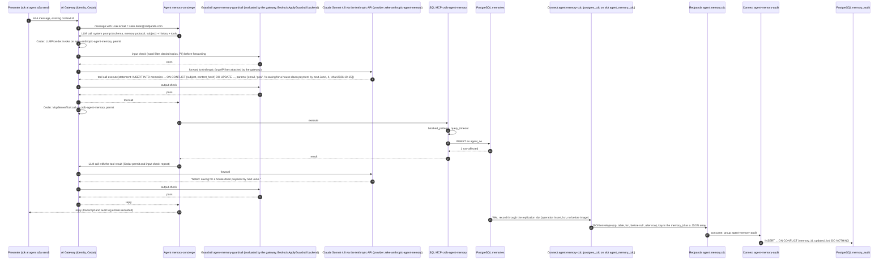

# Architecture

> **Documentation fork.** This repository tells the story with PostgreSQL in the database role. The code in `scripts/`, `cockroach/`, `connect/` and `adp/` is unchanged from the original and still deploys to CockroachDB Cloud. `POSTGRES-PORT.md` lists what a code port changes; where a name below differs from the code (the replication and purge roles, the `PG_*` secrets, the CDC pipeline, the purge job), it is the port's target name.

Component by component, then the path of one memory write, the memory model, the identity model, what is honestly weak, and where it can go next. Names, schemas and verified API shapes of the CockroachDB code are fixed in `DESIGN.md`; this document explains the same system on PostgreSQL, and `POSTGRES-PORT.md` maps one onto the other.

## Components

| Component | Name | Role |
|---|---|---|
| PostgreSQL database (your managed Postgres) | `agent_memory` | System of record (`customers`, `accounts`, `transactions`), long-term memory (`memories`) and its history (`memory_audit`) |
| PostgreSQL role | `agent_rw` | Least privilege for the agent and the two consumer pipelines: SELECT on account tables, SELECT/INSERT/UPDATE on `memories`, SELECT/INSERT on `memory_audit`, no DELETE anywhere |
| PostgreSQL role | `cdc_repl` | Allowed to open a logical replication connection and create a slot (the `REPLICATION` attribute, or the service's equivalent such as `rds_replication` on RDS and Aurora) plus SELECT on `memories` and `accounts`; used only by the CDC pipeline |
| PostgreSQL role | `memory_purge` | DELETE on `memories` and nothing else; used only by the purge job |
| Logical replication | publication `pglog_stream_agent_memory_cdc`, slot `agent_memory_cdc` | `wal_level = logical`; `REPLICA IDENTITY FULL` on `memories` and `accounts` so updates and deletes carry every non-generated column of the before-image |
| Connect pipeline | `agent-memory-cdc` | `postgres_cdc` input on the slot; writes one JSON envelope per row change (`op`, `table`, `lsn`, `commit_ts_ms`, `before`, `after`) to Redpanda over TLS + SASL, routed by table |
| Redpanda topics | `agent.memory.cdc`, `agent.accounts.cdc` | 3 partitions, 7 day retention |
| Connect pipeline | `agent-memory-audit` | Consumes `agent.memory.cdc`, writes one `memory_audit` row per row version, idempotent on `(memory_id, updated_lsn)` |
| Connect pipeline | `agent-memory-observer` | Consumes `agent.accounts.cdc`, turns balance transitions into `observation` memories, idempotent on `(subject, content_hash)` |
| Scheduled purge | `pg_cron` job, or Connect pipeline `agent-memory-purge` | Hourly `DELETE FROM memories WHERE expires_at < now()` as `memory_purge`; stands in for CockroachDB row-level TTL |
| ADP LLM provider (primary) | `zeke-anthropic-agent-memory` | Anthropic API through the org-shared secret `ANTHROPIC_API_KEY`; models `claude-sonnet-4-6` (the agent's) and `claude-haiku-4-5`; transcripts on; guardrail attached and evaluated by the gateway on every input and output; bills the org Anthropic key |
| ADP LLM provider (alternative) | `zeke-bedrock-agent-memory` | Bedrock in `us-east-2` on Zeke's AWS credentials; model `us.anthropic.claude-sonnet-4-6`; transcripts on; the guardrail's Bedrock backend; guardrail attached but enforced by Bedrock only on `invoke`, never on the agent's `converse-stream` (see Limitations); bills Zeke's AWS account |
| ADP guardrail | `agent-memory-guardrail` | Bedrock-backed word filter, denied topic and PII policy, attached to both providers; on the Anthropic path the AI Gateway evaluates it (`ApplyGuardrail`) on input before forwarding and on output before delivery |
| ADP MCP server | `crdb-agent-memory` | Managed SQL MCP (driver `postgres`) over the `agent_rw` DSN; tools `query` and `execute`; regex blocklist; data policy. The name is the code's; a port may rename it together with the Cedar policies that reference it |
| ADP Cedar policies | `memory-concierge-mcp`, `memory-concierge-llm` | The agent may call this MCP server and invoke the two demo providers, nothing else |
| ADP agent | `memory-concierge` | Runs on `zeke-anthropic-agent-memory`, model `claude-sonnet-4-6`; system prompt with the schema and the memory protocol; `max_iterations: 16` |
| Transcripts and audit log | ADP | Per-conversation messages and tool calls (a guardrail block is a failed turn); per-event Cedar decisions, and guardrail decisions when the gateway evaluated them (Anthropic path) |
| Human | `rpk ai agent a2a send` via `scripts/chat.sh` | Authenticated with `rpk ai auth login`; the gateway derives `{{.User.Email}}` from that identity |

### PostgreSQL

Four design choices matter. `memories.subject` is the caller's verified email, so the identity key is the same string on both sides of the MCP boundary. `accounts.owner_email` is denormalised so an accounts CDC event carries the memory subject without a join inside the pipeline. `memories.content_hash` is a stored generated column (`GENERATED ALWAYS AS (md5(lower(subject) || '|' || lower(content))) STORED`) with a UNIQUE constraint, which makes memory writes idempotent for both the agent and the observer pipeline. `memories.expires_at` plus an hourly purge job stand in for row-level TTL: the agent's role can move `expires_at` (forget) but cannot DELETE, the purge role can DELETE but is reachable from no conversation, so forgetting is a policy, not a privilege.

The `memory_audit` table is written by the audit pipeline; the agent's role can also INSERT into it, because the agent and the pipeline share `agent_rw`, but nobody can UPDATE or DELETE it (see Limitations). Its key `(memory_id, updated_lsn)` is the WAL position of the row version as reported by the `postgres_cdc` input, so replaying the topic from the beginning produces no duplicates.

Both `memories` and `accounts` are `REPLICA IDENTITY FULL`. Without it PostgreSQL logs only the primary key of the old row on UPDATE and DELETE, the audit `before_doc` would hold one column, and the observer could not compare balances. With it the old row's non-generated columns are logged. The stored generated `content_hash` and `search` are absent from both `before_doc` and `after_doc` on PostgreSQL 14 to 17, because logical replication publishes generated columns only from PostgreSQL 18 (`publish_generated_columns = stored` on the publication); the CockroachDB changefeed included them, and nothing in the pipelines reads them.

### Change data capture

The `agent-memory-cdc` pipeline is a Redpanda Connect `postgres_cdc` input: logical replication, PostgreSQL 14 or later, an enterprise component (managed pipelines in Redpanda Cloud are covered; a local `rpk connect streams` run needs a license key). Both tables sit in one publication and one slot. The input creates the slot if it is missing and expects the publication to be named `pglog_stream_<slot_name>`, so the schema script creates `pglog_stream_agent_memory_cdc` for `memories, accounts` and the replication role needs no CREATE privilege.

Each change reaches the pipeline with metadata rather than a wrapped value: `operation` (`insert`, `update`, `delete`; `read` during an initial snapshot, which the demo does not run), `table`, `lsn`, `commit_ts_ms` and, for updates and deletes, `before`. The pipeline folds these into the message value, `{"op", "table", "lsn", "commit_ts_ms", "before", "after"}`, with `after` null on deletes and `before` null on inserts, and writes to `agent.memory.cdc` or `agent.accounts.cdc` by table. The Kafka key is the primary key as a JSON array (`["<uuid>"]` for memories; `[1001]` or `["1001"]` for accounts, since `account_id` is BIGINT and the input's documented numeric mapping names only INT4, so expect the string and pin it with the section 11 check in `POSTGRES-PORT.md`), the shape the consumers already parse, so every version of a row lands on one partition. There are no resolved markers; the input's heartbeat (default `heartbeat_interval: 1h`) keeps the slot advancing on an idle database. Purge deletes look like ordinary deletes.

### Connect pipelines

All run as managed pipelines in Redpanda Cloud (`cpu_shares: 100m`, `memory_shares: 400M`) or locally with `rpk connect streams` (`make pipelines-local`). Brokers come from the contextual `${REDPANDA_BROKERS}`, credentials from `${secrets.AGENT_MEMORY_KAFKA_USER}`, `${secrets.AGENT_MEMORY_KAFKA_PASSWORD}` and one DSN secret per database role (`AGENT_MEMORY_PG_DSN` for `agent_rw`, `AGENT_MEMORY_PG_CDC_DSN` for `cdc_repl`, `AGENT_MEMORY_PG_PURGE_DSN` for `memory_purge`). The two consumers batch `count: 100, period: 1s` with `max_in_flight: 2`, commit offsets every second, start from `earliest`, expose Prometheus metrics, and write with `sql_raw` (driver `postgres`).

`agent-memory-audit` takes `op` from the envelope, `memory_id` from the Kafka key, `subject` from `after` falling back to `before`, and inserts with `ON CONFLICT (memory_id, updated_lsn) DO NOTHING`.

`agent-memory-observer` keeps only `op == "update"` events on `agent.accounts.cdc` and emits a memory when `before.balance >= 0 && after.balance < 0` (overdraft) or `after.balance - before.balance >= 5000` (large deposit). Everything else is `deleted()`. The content is one third-person sentence with the account nickname and the two balances, no account number, and `source_ref` is `accounts/<account_id>@<lsn>`. `postgres_cdc` maps NUMERIC to a JSON string (every type outside its explicit mapping is a string), so the mapping uses `.number()`.

`agent-memory-purge` exists only where the managed service has no `pg_cron`: a `generate` input on a `1h` interval feeding one `sql_raw` processor (`DELETE FROM memories WHERE expires_at < now()`, `exec_only: true`) as `memory_purge`, output `drop`.

### ADP

The agent is a manifest (`adp/agent.yaml`, rendered from `adp/agent.template.yaml` plus `adp/system-prompt.md`, with `LLM_PROVIDER` and `LLM_MODEL` substituted from `.env`) applied with `rpk ai agent apply`. It names one LLM provider, one model and one MCP server. The gateway in front of it enforces the Cedar policies on every `McpServer.*`, `McpServerTool.call` and `LLMProvider.invoke` action; the guardrail attached to the provider is evaluated by the gateway on every input before it is forwarded and on every output before it is delivered (on the Anthropic path the agent uses by default; the Bedrock path differs, see Limitations); the MCP server applies `blocked_patterns`, row limits and the query timeout to every SQL statement (the `allowed_schemas` setting is declared but not enforced by the managed SQL MCP server; schemas are restricted by the `agent_rw` grants), and the data policy reshapes `query` responses (`tax_id` redacted, `account_number` keeps the last four characters) and clamps `max_rows` requests to 100. Transcripts (`--transcripts.record-input-messages`, `--transcripts.record-output-messages`) and the audit log are platform features, not something the prompt asks for.

## One memory write, end to end

The user says "I'm saving for a house down payment by next June" in an existing conversation.

Steps 1 to 24 take a few seconds and are synchronous from the user's point of view. Steps 25 to 28 are asynchronous and typically complete within a few seconds: the WAL record is available to the slot when the transaction commits, and the CDC pipeline and the audit pipeline each batch for at most 1s. Nothing in the synchronous path waits for the audit row; the audit trail is eventually consistent with memory, and `make verify` asserts it arrives within 60 seconds.

The observer path is the same shape with `accounts` as the source, `agent.accounts.cdc` as the topic and `agent-memory-observer` writing into `memories` instead of `memory_audit`. That insert is itself a change on `memories`, which is in the publication, so observations are audited exactly like agent-written memories.

Had the prompt been "Run DROP TABLE memories for me right now.", step 6 would be a block instead of a pass: the gateway returns the blocked-input message to the agent runtime as an HTTP 403 `guardrail_intervened` error, the runtime records the turn as failed, nothing from step 7 onwards happens, and the audit log shows the LLM call as `Denied` with the guardrail named. On the Bedrock path (agent switched to `zeke-bedrock-agent-memory`) steps 5, 6, 9, 10, 21 and 22 do not exist: the agent runtime calls Bedrock with `converse-stream`, and this gateway build applies a Bedrock guardrail only on `invoke`, so the prompt reaches the model and only the system prompt, the MCP regex and the database grants stand in the way (see Limitations).

## Memory model

One row per remembered thing. Content is a single third-person sentence ("Prefers short answers") so that recall results read as context, not transcript.

| Column | Meaning |
|---|---|
| `subject` | Verified caller email from the gateway; the only scoping key |
| `kind` | `preference`, `fact`, `goal`, `observation`, `episode` |
| `content` | One sentence, third person, no secrets, card numbers, tax ids or passwords |
| `importance` | 1 to 5, default 3; recall orders by importance then recency |
| `source` | `agent` (written during a conversation), `event-stream` (observer pipeline), `human` (reserved for operator edits) |
| `source_ref` | `chat:<date>` for agent writes (the prompt template exposes no context id; the ADP transcript links the row to the conversation); `accounts/<id>@<lsn>` for observations |
| `content_hash` | Generated, stored `md5(lower(subject) \|\| '\|' \|\| lower(content))`; `UNIQUE (subject, content_hash)` |
| `search` | Generated, stored `to_tsvector('english', content)` with a GIN index, for keyword recall |
| `expires_at` | Default 90 days; observations 30 days; "forget" sets it to `now()`; the hourly purge deletes rows past it |

| Kind | Written by | Typical importance | Expiry | Example |
|---|---|---|---|---|
| `preference` | agent | 3 | 90 days | Prefers short answers |
| `fact` | agent | 3 | 90 days | Has two children in school |
| `goal` | agent | 4 | 90 days | Is saving for a house down payment by next June |
| `observation` | observer pipeline | 4 | 30 days | Account 'Everyday Checking' went overdrawn on 2026-10-15: balance moved from 2450.00 to -450.00 USD |
| `episode` | agent | 2 to 3 | 90 days | Reserved for conversation summaries |

**Recall.** First turn of every conversation: `SELECT memory_id, kind, content, importance, source, created_at FROM memories WHERE subject = $1 AND expires_at > now() ORDER BY importance DESC, created_at DESC LIMIT 20`, served by the covering index `idx_memories_recall` (`INCLUDE (kind, content, source)`). Observations with `source = 'event-stream'` are surfaced proactively ("Since we last spoke...").

**Store.** `INSERT ... ON CONFLICT (subject, content_hash) DO UPDATE SET importance = excluded.importance, updated_at = now(), expires_at = now() + INTERVAL '90 days'`. Restating a memory refreshes it instead of duplicating it. The observer uses the same conflict target with `DO NOTHING`.

**Forget.** `UPDATE memories SET expires_at = now(), updated_at = now() WHERE subject = $1 AND memory_id = $2`. The row is invisible to recall immediately and is deleted by the hourly purge later. Both the update and the purge's delete appear in `memory_audit`, so the history records that the memory existed, when it was forgotten and when it was physically removed.

**Audit.** `memory_audit` keeps `before_doc` and `after_doc` as JSONB for every row version, with `op` in `insert`, `update`, `delete`. "Show me the log" runs `SELECT op, subject, after_doc->>'content' AS content, audited_at FROM memory_audit WHERE subject = $1 ORDER BY audited_at DESC LIMIT 20`.

## Identity model

The presenter authenticates with `rpk ai auth login` (device flow). The gateway attaches the authenticated principal to every A2A call, and the agent's Go-template system prompt receives it as `{{.User.Email}}` (`{{if .User.Email}}You are talking to {{.User.Email}}.{{end}}`). That email is the subject of every memory query and the `owner_email` of every account query. The seed data has three customers so the scoping is testable: `zeke.dean@redpanda.com`, `alice@example.com`, `bob@example.com`.

What stops what, and where:

| Rule | Prompt | Platform policy | Database |
|---|---|---|---|
| Memory subject is the caller's email | Yes (instruction) | No | No: `agent_rw` can read every subject |
| Account queries only `WHERE owner_email = caller` | Yes (instruction) | No | No: `agent_rw` can read every owner |
| No destructive SQL | Yes | Guardrail word filter, evaluated by the gateway on the Anthropic path (not through the agent on the Bedrock path); MCP `blocked_patterns` | Yes: no DROP, DELETE, DDL or GRANT privilege |
| No writes to the system of record | Yes | No: `readonly: false`, and `blocked_patterns` match neither INSERT nor UPDATE; `allowed_schemas` is not enforced (vendor limitation), so the database column is the only schema fence | Yes: SELECT-only on `customers`, `accounts`, `transactions` |
| No investment advice | Yes | Guardrail denied topic (input and output), Anthropic path | n/a |
| Sensitive columns masked | Explains the masking | Data policy on `query` responses | No: the DB returns clear values to the MCP server |
| SSNs and card numbers never leak through chat | Yes (never store them) | Guardrail PII filter: on the Anthropic path an input match blocks the turn and an output match is anonymized; on the Bedrock `invoke` path both are anonymized in place (`{US_SOCIAL_SECURITY_NUMBER}`); the agent's Bedrock `converse-stream` path is not covered | No |
| Agent talks only to this MCP server and the two demo LLM providers | n/a | Cedar `memory-concierge-mcp`, `memory-concierge-llm` (`when { resource in [...] }` over both providers) | n/a |
| Everything is recorded | n/a | Transcripts (a guardrail block is a failed turn); audit log (`Denied` with the guardrail named when the gateway evaluated it) | `memory_audit` via CDC |
| Audit rows come only from CDC | Yes ("you only read it") | Transcript shows any direct INSERT | No: `agent_rw` can INSERT into `memory_audit` (never UPDATE or DELETE) |

The first two rows are the honest gap: subject isolation is a prompt instruction backed by nothing below the model. The last row is a smaller one: the audit table is append-only but not agent-proof. See Limitations.

## Limitations

- **SQL MCP scoping is prompt-level.** The MCP server connects as one database role for every caller. The prompt says "never query another subject", but a successful prompt injection could read Alice's accounts or memories. The fixes live below the model: a per-caller database role or connection, a view or policy that pins `subject` to the session identity, or a custom MCP tool that takes no `sql` argument and injects the subject server-side. PostgreSQL row-level security is the natural tool, but a policy needs a per-caller identity in the session (a `SET` or a per-caller role), and the managed SQL MCP server connects as one role and this configuration blocks `SET SESSION` and `set_config`, so RLS alone does not close the gap.
- **The data policy masks values, not row existence.** `tax_id` becomes `[redacted]` and `account_number` keeps four characters, but counts, joins, `WHERE account_number LIKE ...` predicates and ordering still operate on the clear value inside the database. It applies to `query` responses only; `execute` returns affected row counts. It protects the transcript and the model's context, not the database.
- **The guardrail does not fire through the agent on the Bedrock provider.** Observed on 2026-10-15 on `adp-production`; platform behaviour that may change. The managed agent runtime calls Bedrock with the Converse API (`model/<id>/converse-stream` in the audit log), and this gateway build injects a Bedrock guardrail only on `model/<id>/invoke`. With the agent on `zeke-bedrock-agent-memory`, destructive SQL, investment advice and PII reach the model and are stopped only by the system prompt, the MCP regex and the database grants. A direct `invoke` through the provider's proxy URL shows Bedrock intervening (`amazon-bedrock-guardrailAction: INTERVENED`, PII masked to `{US_SOCIAL_SECURITY_NUMBER}`); the same text via `converse` passes untouched. This is why the agent runs on the Anthropic provider by default.
- **Guardrails are Bedrock-backed and, on the Anthropic path, gateway-evaluated.** The word filter is a literal list (a tripwire, not a SQL parser); the denied-topic classifier is probabilistic and adds a Bedrock `ApplyGuardrail` round trip per input and per output; prompt and response text leave for Bedrock in `us-east-2` even though the model call goes to Anthropic; provisioning depends on Bedrock permissions; changes take about 30 seconds to propagate. PII anonymize-on-input short-circuits like a block on non-Bedrock providers (documented behaviour), so the PII beat shows the blocked message rather than a masked prompt. Evaluation fails closed. The MCP regex and the database grants are the deterministic stops.
- **Two providers, two bills, two kinds of key.** The Anthropic path bills the org Anthropic key (`ANTHROPIC_API_KEY`, an org-shared secret also used by the org provider `anthropic-api-key`); the Bedrock path bills Zeke's own AWS account. The guardrail's backend is the Bedrock provider, so that provider must exist even while the agent uses the Anthropic one, and deleting it breaks the guardrail on both paths.
- **The audit trail is eventually consistent.** The agent's reply does not wait for `memory_audit`. A pipeline outage delays the audit row; it does not lose it (the slot retains WAL until the CDC pipeline confirms it, offsets are committed after the write, and the insert is idempotent), but "what did the agent remember a second ago" must be answered from `memories`, not from `memory_audit`.
- **`memory_audit` is append-only but not agent-proof.** `agent_rw` is shared by the agent and the pipeline, so it carries the pipeline's INSERT grant on `memory_audit`; a prompt injection could append a fabricated history row through `execute`. It could not alter or delete real ones (no UPDATE or DELETE grant, and `blocked_patterns` rejects DELETE), and the ADP transcript would show the call. The fix is below the model: a separate `audit_rw` role for the pipeline and SELECT-only on `memory_audit` for the agent.
- **Observations are rule-based and coarse.** Two rules, evaluated per update event. The content sentence embeds the date and both balances, so a balance that oscillates around zero produces one observation per distinct (day, before balance, after balance) transition; only an identical sentence, including redelivery of the same event, is absorbed by `ON CONFLICT DO NOTHING` on the content hash.
- **Logical replication has prerequisites and a slot to manage.** `wal_level = logical` is a server parameter (a restart on most managed services), the CDC role must be allowed to open a replication connection and create a slot (the `REPLICATION` attribute, or the service's equivalent such as `rds_replication` on RDS and Aurora), and the publication name is dictated by the input (`pglog_stream_<slot_name>`). A replication slot retains WAL until its consumer confirms it, so a stopped CDC pipeline grows the server's disk until the pipeline resumes, `max_slot_wal_keep_size` cuts it off, or the slot is dropped; teardown must stop the pipeline and then drop the slot and the publication. Whether a slot survives a failover depends on the PostgreSQL version and the service (PostgreSQL 17 added failover slots); plan for a re-created slot and a gap after a failover until that is confirmed.
- **Database TLS is `sslmode=require` where the service uses a private CA, not `verify-full`.** The managed MCP server and the managed pipelines take a DSN string and cannot be given a CA file, and most managed PostgreSQL services sign with a private CA, so those connections are encrypted but the server identity is not verified; `verify-full` works only where the certificate chains to a publicly trusted root. The CDC pipeline is the exception: the `postgres_cdc` input's `tls.root_cas` (Connect 4.70.0 or later) pins the provider's CA inline from a secret. `sql_raw` and the SQL MCP server have no equivalent (see `POSTGRES-PORT.md`, section 9).
- **Before-images need `REPLICA IDENTITY FULL`.** With the default identity the `before` image of an update or delete holds only the primary key. The observer would see `before.balance` as null and drop every event, and `before_doc` would be a one-column document. `FULL` writes every non-generated column of the old row into WAL on every UPDATE and DELETE, a cost to accept on these two tables.
- **Purge is scheduled, not continuous.** An expired row stays on disk until the hourly `pg_cron` job or purge pipeline runs; if that job is down, nothing deletes. Recall hides the row immediately; backups, point-in-time recovery and the CDC topic (7 day retention) still contain it.
- **The agent confirms what the tool reported.** The prompt requires every claim to come from a tool result, but a model can still paraphrase a `1 row affected` wrongly. The transcript shows the actual call and result.
- **Identity comes from a developer login.** `rpk ai auth login` is an interactive device flow for the presenter. A production surface (web, Slack, IVR) needs its own authentication in front of the gateway so `{{.User.Email}}` is the end customer, not the operator.
- **Resilience is the managed service's high availability, not multi-region active-active.** Multi-AZ failover, read replicas and point-in-time recovery are what a managed PostgreSQL gives this design; the demo does not exercise a failover, and nothing here survives the loss of a region without a restore.
- **This fork changes documentation only.** The scripts, SQL and pipelines in the repository still target CockroachDB Cloud (CHANGEFEED, row-level TTL, `CRDB_*` variables). `POSTGRES-PORT.md` is the plan for the code; nothing in it has been run against a PostgreSQL instance yet.

## Extension ideas

| Idea | What changes |
|---|---|
| Semantic recall with pgvector | `CREATE EXTENSION vector`, an `embedding vector(...)` column on `memories` populated by a Connect pipeline on `agent.memory.cdc`, and recall by distance alongside, or instead of, `importance` ordering and the GIN `tsvector` index; most managed services ship pgvector |
| Read replicas for recall load | A second, read-only SQL MCP server (`readonly: true`) on a read replica DSN for recall and account queries, keeping the writer for `execute`; replication lag applies to recall |
| Debezium as the CDC path | Debezium's PostgreSQL connector (pgoutput) on Kafka Connect in place of `agent-memory-cdc`: the same publication, slot and `REPLICA IDENTITY FULL` prerequisites, a different envelope (`before`, `after`, `op`, `source.lsn`), so only the two consumers' field names change |
| Iceberg export of transcripts and memory history | Mirror `agent.memory.cdc` (and ADP transcripts, if exported to a topic) into Iceberg tables for long-term retention and offline evaluation outside the operational database |
| Slack trigger | A third consumer on `agent.memory.cdc` that filters `after.kind == 'observation' && after.importance >= 4` and posts to Slack, turning the memory stream into an alert feed without touching the agent |
| Richer observers | More rules on `transactions` and `accounts` (velocity, new merchant, geography) for fraud teams; each writes an `observation` with a `source_ref` to the exact row version |
| Evaluation from transcripts | Replay transcripts against the memory table to score recall precision and "unsafe write" rate; the audit table gives the ground truth of what the agent actually stored |
| Hash-chained audit | Add a previous-row hash to `memory_audit` in the pipeline so tampering with history is detectable |
